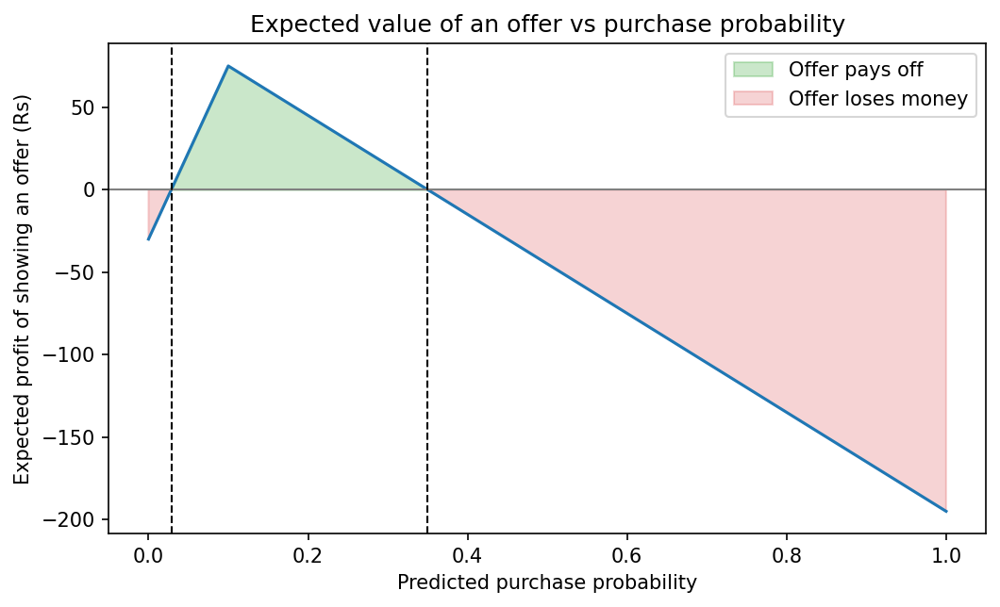
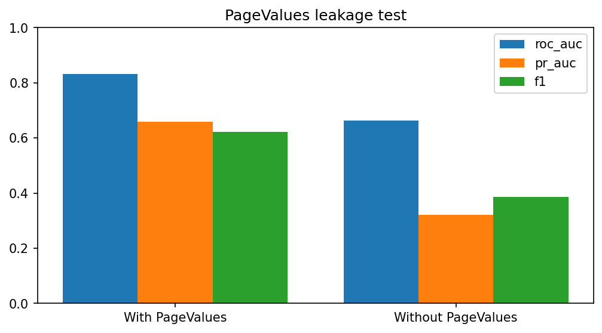
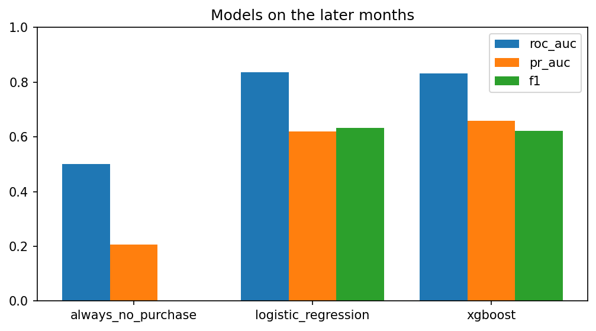
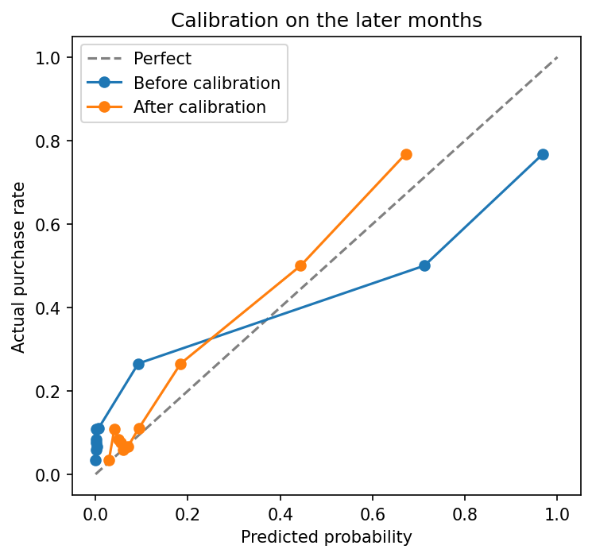
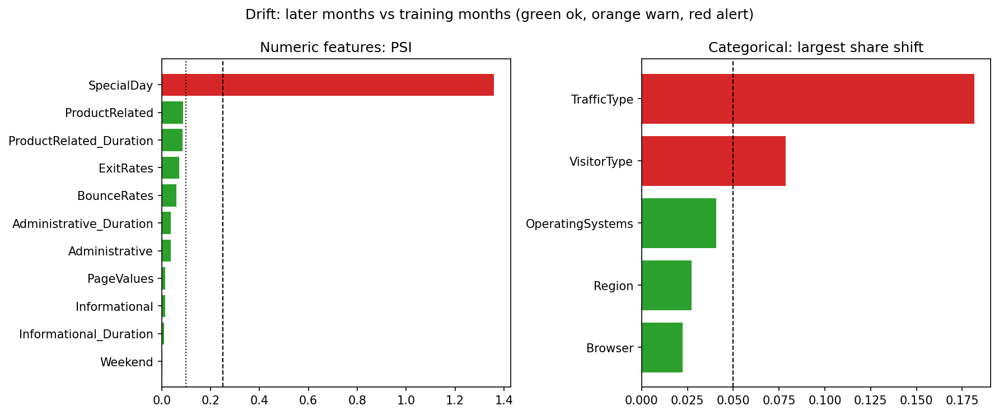

# Purchase Intent Predictor

Predicts how likely an online shopping session is to end in a purchase, then turns that probability into a business decision (show an offer or not).

**Live demo:** [Streamlit app](https://purchase-intent-ml-sk.streamlit.app/) | **API docs:** [FastAPI /docs](https://purchase-intent-ml-1k0g.onrender.com/docs)

> The API runs on a free Render server that sleeps when idle. The first request after a break can take up to a minute to wake up. On the live server, per-prediction explanations (SHAP) are switched off to fit in 512 MB of memory. They work locally.

A shop cannot give every visitor a discount, and most visitors (about 84%) never buy. This project scores each session with a purchase probability, then picks only the visitors where an offer actually pays off. The charts below are the evidence.

<table>
  <tr>
    <td align="center">
      <br>
      <sub><b>Decision bands.</b> An offer only pays off for scores between about 0.03 and 0.35.</sub>
    </td>
    <td align="center">
      <br>
      <sub><b>Leakage test.</b> ROC-AUC falls from 0.83 to 0.66 without PageValues.</sub>
    </td>
  </tr>
  <tr>
    <td align="center">
      <br>
      <sub><b>Model comparison</b> on the later months: always-no, logistic regression, XGBoost.</sub>
    </td>
    <td align="center">
      <br>
      <sub><b>Calibration.</b> Predicted probabilities against what really happened.</sub>
    </td>
  </tr>
</table>

<p align="center">
  <br>
  <sub><b>Drift.</b> 3 of 16 features changed a lot between the training months and the later months.</sub>
</p>

## What is this project?

Imagine an online shop. A visitor browses products, spends time on pages, and either buys or leaves. This system takes the details of one session (product pages viewed, time spent, exit and bounce rates, visitor type, weekend or not, and so on) and returns a **purchase probability**, for example 0.72. That is the model's estimate, not a guarantee.

A probability alone does not help a shop, so the project adds a **decision layer**. Showing an offer costs money, and it wastes money on people who would buy anyway. Using assumed business costs (a Rs 300 discount, a Rs 1,200 sale, Rs 30 per offer shown), the code works out the range of scores where an offer has positive expected value. That range is derived from the numbers in `config.yaml`, not typed in by hand, so changing a cost moves the bands.

Around the model there is a small production system: a FastAPI backend (`/predict`, `/explain`, `/health`), a Streamlit front end, probability calibration, SHAP explanations of each score, a drift check that compares new traffic to training data, tests, and CI. The data is the UCI Online Shoppers Purchasing Intention dataset (12,330 sessions, collected around 2017). This is a learning and portfolio project, not a production recommender.

## Results at a glance

Train on the earlier months (Feb to Aug), test on the later months (Sep to Dec).

| Check | Result |
|---|---|
| Logistic regression baseline, test ROC-AUC | 0.836 |
| XGBoost, test ROC-AUC / PR-AUC | 0.832 / 0.658 |
| XGBoost, cross-validation ROC-AUC (training months) | 0.959 |
| XGBoost without PageValues, test ROC-AUC | 0.662 |
| Calibration, Brier score (lower is better) | 0.128 to 0.112 |
| Derived offer band | 0.029 to 0.349 predicted probability |
| Drift, features flagged | 3 of 16 |

## Findings

- **A random split would have misled me.** Cross-validation shuffles rows from the same months and reports 0.96. Testing on genuinely later months gives 0.83. Splitting by time is the honest number.
- **The model leans on one feature.** Dropping `PageValues` costs about 0.17 ROC-AUC. That feature is built from how much revenue pages have generated, so it partly encodes the outcome. In a live system you would need to confirm it only uses past data.
- **November is the weak month.** It is over half the test set, has the highest purchase rate (25.5%), and has the lowest ROC-AUC (0.81) and recall (0.55). The training months never saw Black Friday season.
- **XGBoost did not beat logistic regression on ROC-AUC** (0.832 vs 0.836). It only gained on PR-AUC. With a shift between periods, a stronger model buys little.
- **Calibration helped but cannot fix a base-rate shift.** The model still predicts about 17% on average where the later months actually buy at 20.7%.
- **Drift is real but modest.** `SpecialDay`, `TrafficType` and `VisitorType` moved. `PageValues`, the main driver, stayed stable. Drift only shows inputs changed, not that the model got worse.

## How it is built

```
CSV -> clean -> split by month -> pipeline (impute, scale, one-hot) -> XGBoost
    -> sigmoid calibration (held-out Jul-Aug) -> bands from business costs
    -> FastAPI (/predict, /explain, /health) -> Streamlit UI
    -> drift check (later months vs training months)
```

```
config.yaml            all tunable settings and business assumptions
scripts/               download_data.py, build_artifacts.py
src/data, features     loading, cleaning, month split, preprocessing
src/training           baselines, XGBoost, cross-validation, run records
src/evaluation         metrics, plots, error analysis, PageValues test
src/calibration        calibrated model wrapper and curve
src/decision           expected value and band derivation
src/explain            SHAP reasons and summary chart
src/drift              PSI, category shifts, report
app/                   FastAPI routes, schemas, startup loading
ui/                    Streamlit app and tabs
tests/                 API, decision maths and drift tests
```

## Run it, use it, know its limits

Windows PowerShell, Python 3.12:

```powershell
py -3.12 -m venv .venv
.venv\Scripts\activate
pip install -r requirements.txt
python -m scripts.build_artifacts      # downloads data, trains, calibrates, derives bands
python -m pytest -q
uvicorn app.main:app --reload          # API at http://127.0.0.1:8000/docs
streamlit run ui/streamlit_app.py      # UI at http://localhost:8501
```

Example call:

```powershell
Invoke-RestMethod -Method Post -Uri http://127.0.0.1:8000/predict -ContentType "application/json" `
  -Body '{"ProductRelated": 30, "ProductRelated_Duration": 1200, "PageValues": 3, "ExitRates": 0.03}'
# {"probability": ..., "action": "show_offer" | "no_action", "model_version": "v1"}
```

Settings can be overridden with environment variables, for example `PIM_MODEL__VERSION=v2` or `PIM_FEATURES__DROP='["PageValues"]'`.

Limits to keep in mind:

- The data is from about 2017 and one site, so it does not reflect today's shoppers.
- The business costs are assumptions, not real figures. The offer band is only as good as they are.
- The model depends heavily on `PageValues`, and its November performance is weak.
- Drift monitoring here is a simulation on historical months, not live traffic.

## What I'd do differently

- Confirm how `PageValues` is computed, and drop or rebuild it if it uses information from after the session.
- Estimate the real effect of an offer with an A/B test instead of assuming a 15% lift.
- Train on a full year of data so seasonal peaks like November are seen in training.
- Track drift on live traffic and retrain automatically when it crosses the alert level.
- Return SHAP explanations on the live server by moving to a host with more memory.